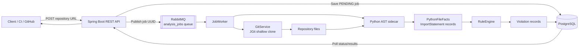
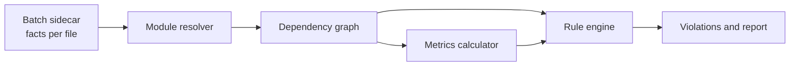

# ArchGuard Engine — Project Documentation

This document consolidates the project overview, contributor guide, restart notes,
current implementation status, local setup, architecture, testing guidance, and
roadmap for ArchGuard Engine.

> **Document purpose:** Use this as the single onboarding and project-reference
> document. The original `README.md`, `PROJECT_GUIDE.md`, and `NEXT_STEPS.md`
> files can remain as source documents, but this file is the recommended starting
> point after returning to the project.

---

## 1. Project Summary

ArchGuard is an **event-driven architectural linter**. Traditional linters
usually check syntax, formatting, individual lines, or local code smells.
ArchGuard checks system structure:

> Is a module allowed to depend on another architectural layer or technology?

The current implemented rule is:

```text
DB_CALL_IN_VIEW_LAYER
```

It reports a violation when a view/UI Python file imports a database driver or
ORM directly, instead of accessing persistence through an application/service
or data-access layer.

Example violation:

```python
# app/views/profile.py
import sqlalchemy
```

Desired dependency direction:

```text
View/UI layer
      |
      v
Application/service layer
      |
      v
Data-access layer
      |
      v
Database
```

### Current maturity

The asynchronous Python analysis pipeline works end to end:

```text
GitHub URL
  -> REST API
  -> PostgreSQL job row
  -> RabbitMQ message
  -> worker
  -> shallow Git clone
  -> Python files
  -> Python AST sidecar
  -> normalized import facts
  -> architectural rule
  -> PostgreSQL violations
  -> REST results
```

The project is still evolving. Dependency graphs, cycle detection,
repository-specific configuration, architecture metrics, and broader GitHub
integration are planned rather than fully implemented.

---

## 2. System Architecture



### Core design principle: language-specific sidecars

The Java service orchestrates work and applies language-independent rules.
Language parsing is delegated to a native parser:

```text
Python source
    |
    v
Python ast module
    |
    v
Common JSON format
    |
    v
Java domain facts
    |
    v
Architectural rules
```

This keeps Python parsing out of Java and provides a path for future JavaScript,
C#, Java, or .NET/Roslyn sidecars.

### Technology stack

- Java 17
- Spring Boot 3.1
- Spring Web
- Spring AMQP / RabbitMQ
- Spring Data JPA
- PostgreSQL
- JGit
- Python 3 and the standard-library `ast` module
- Docker Compose
- Maven (downloaded by the Maven wrapper)
- JUnit 5 and Spring Boot Test

---

## 3. Repository Map

```text
archguard-engine/
├── pom.xml
├── README.md
├── PROJECT_GUIDE.md
├── NEXT_STEPS.md
├── ARCHGUARD_PROJECT_DOCUMENTATION.md
├── docker-compose.yml
├── .env.example
├── sidecars/
│   └── python/
│       └── parser.py
└── src/
    ├── main/
    │   ├── java/com/archguard/
    │   │   ├── Main.java
    │   │   ├── AnalysisController.java
    │   │   ├── JobWorker.java
    │   │   ├── GitService.java
    │   │   ├── SidecarExecutor.java
    │   │   ├── PythonFileFacts.java
    │   │   ├── ImportStatement.java
    │   │   ├── RuleEngine.java
    │   │   ├── GlobMatcher.java
    │   │   ├── RepositoryUrlValidator.java
    │   │   ├── RabbitMQConfig.java
    │   │   ├── GitHubReportingService.java
    │   │   ├── api/
    │   │   ├── models/
    │   │   └── repositories/
    │   └── resources/
    │       ├── application.properties
    │       └── application-local.properties
    └── test/
        ├── java/com/archguard/
        └── resources/
            └── views/test_view.py
```

Generated Maven output under `target/` is build output and should not be used as
the source of truth.

---

## 4. End-to-End Job Lifecycle

### 4.1 Submit a job

The client sends a public GitHub HTTPS repository URL:

```text
POST /api/jobs
Content-Type: text/plain
```

The controller:

1. Validates and canonicalizes the URL.
2. Saves an `AnalysisJob` with status `PENDING`.
3. Publishes the job UUID to RabbitMQ.
4. Returns `202 Accepted`, a `Location` header, and the initial job response.

### 4.2 Process the job

The worker:

1. Receives the job UUID from RabbitMQ.
2. Discards malformed or unknown job messages without endlessly requeueing them.
3. Marks the job `IN_PROGRESS`.
4. Deletes violations from an earlier retry.
5. Creates a job-specific workspace.
6. Performs a shallow, no-tags, no-submodules clone.
7. Finds Python files while skipping VCS metadata, virtual environments, caches,
   `node_modules`, and similar directories.
8. Runs the Python sidecar for each file.
9. Skips files with parse-level errors and increments `filesSkipped`.
10. Evaluates the architectural rule.
11. Saves violations.
12. Marks the job `COMPLETED` or `FAILED`.
13. Deletes the temporary clone in all success and failure cases.

### 4.3 Job state machine

```text
PENDING
   |
   v
IN_PROGRESS
   |             \
   v              v
COMPLETED       FAILED
```

| Status | Meaning |
|---|---|
| `PENDING` | Saved in PostgreSQL and waiting in RabbitMQ. |
| `IN_PROGRESS` | The worker is cloning or analyzing the repository. |
| `COMPLETED` | Analysis finished; results can be queried. |
| `FAILED` | Repository or infrastructure-level failure prevented analysis. |

### 4.4 File-level versus job-level errors

File-level errors do not fail the whole job:

- Python syntax errors
- Python 2 syntax
- Invalid source encoding
- A file that cannot be parsed

These files are skipped and counted in `filesSkipped`.

Job-level errors fail the job:

- Repository clone failure
- Missing Python executable
- Missing sidecar script
- Sidecar infrastructure failure
- Timeout or failure that prevents analysis from continuing

---

## 5. REST API

### Submit a repository

```bash
curl -X POST http://localhost:8080/api/jobs \
  -H "Content-Type: text/plain" \
  -d "https://github.com/Maheesh09/ArchGuard.git"
```

Only URLs matching the public GitHub HTTPS form are accepted:

```text
https://github.com/<owner>/<repo>
https://github.com/<owner>/<repo>.git
```

Local paths, `file://` URLs, other hosts, and malformed URLs receive `400 Bad
Request`.

### Poll job status

```bash
curl http://localhost:8080/api/jobs/<id>
```

Example response:

```json
{
  "id": "00000000-0000-0000-0000-000000000000",
  "repositoryUrl": "https://github.com/example/project.git",
  "status": "COMPLETED",
  "errorMessage": null,
  "filesAnalyzed": 14,
  "filesSkipped": 1,
  "violationCount": 2,
  "createdAt": "2026-10-11T00:00:00Z",
  "updatedAt": "2026-10-11T00:00:10Z"
}
```

### Read violations

```bash
curl http://localhost:8080/api/jobs/<id>/violations
```

Results are sorted by file path and line number:

```json
[
  {
    "filePath": "app/views/profile.py",
    "lineNumber": 2,
    "rule": "DB_CALL_IN_VIEW_LAYER"
  }
]
```

Unknown jobs return `404`. Malformed UUID path variables return `400`.

---

## 6. Python Sidecar Contract

The current sidecar is invoked with one Python file:

```text
python sidecars/python/parser.py path/to/file.py
```

Successful output:

```json
{
  "file": "app/views/profile.py",
  "imports": [
    {
      "module": "sqlalchemy.orm",
      "names": ["Session"],
      "level": 0,
      "line": 2
    }
  ],
  "error": null
}
```

Unparseable output:

```json
{
  "file": "app/views/broken.py",
  "imports": [],
  "error": "SyntaxError: invalid syntax (line 8)"
}
```

### Import representation

`ImportStatement` contains:

| Field | Meaning | Example |
|---|---|---|
| `module` | Dotted module name; may be `null` for some relative imports | `sqlalchemy.orm` |
| `names` | Names imported by a `from` import | `Session` |
| `level` | Relative-import depth; `0` means absolute | `1` |
| `line` | One-based source line | `2` |

Examples:

| Python source | Module | Names | Level |
|---|---|---|---:|
| `import os` | `os` | `[]` | 0 |
| `import sqlalchemy.orm` | `sqlalchemy.orm` | `[]` | 0 |
| `from flask import Flask` | `flask` | `["Flask"]` | 0 |
| `from . import models` | `null` | `["models"]` | 1 |
| `from ..database import repository` | `database` | `["repository"]` | 2 |

Relative imports are treated as project-internal by the current rule and are
not classified as forbidden external database modules.

### Sidecar execution safeguards

`SidecarExecutor`:

- Uses `python` on Windows and `python3` elsewhere by default.
- Supports an executable override.
- Keeps stdout and stderr separate.
- Redirects both streams to temporary files.
- Enforces a timeout.
- Reports malformed output explicitly.
- Removes temporary output files in a `finally` block.

---

## 7. Current Rule Engine

### View/UI path matching

The default repository-relative globs are:

```text
**/views/**
**/views.py
**/ui/**
**/ui.py
```

Examples:

| Path | Treated as view/UI? |
|---|---:|
| `views/profile.py` | Yes |
| `app/views/profile.py` | Yes |
| `frontend/ui/dashboard.py` | Yes |
| `app/views.py` | Yes |
| `app/controllers/profile.py` | No |
| `app/models/user.py` | No |
| `app/uikit_helpers.py` | No |

Matching uses normalized repository-relative paths, not the absolute temporary
clone path.

### Forbidden modules

```text
sqlite3
sqlalchemy
psycopg2
psycopg
pymongo
MySQLdb
pymysql
```

Matching is exact or dotted-prefix based:

```text
sqlalchemy       -> matches
sqlalchemy.orm   -> matches
my_sqlalchemy    -> does not match
x.sqlalchemy     -> does not match
```

The rule ignores relative imports because they refer to project-internal code.

---

## 8. Persistence Model

### `analysis_jobs`

| Field | Purpose |
|---|---|
| `id` | UUID primary key |
| `repositoryUrl` | Canonical repository URL |
| `status` | `PENDING`, `IN_PROGRESS`, `COMPLETED`, or `FAILED` |
| `errorMessage` | Truncated failure message |
| `filesAnalyzed` | Number of successfully parsed files |
| `filesSkipped` | Number of files skipped due to parse errors |
| `createdAt` | Creation timestamp |
| `updatedAt` | Last update timestamp |

### `violations`

| Field | Purpose |
|---|---|
| `id` | UUID primary key |
| `jobId` | Related analysis job |
| `filePath` | Repository-relative path |
| `ruleBroken` | Rule identifier |
| `lineNumber` | Import line where the violation was found |

When a job is retried, previous violations are deleted before new results are
inserted, preventing duplicate results.

---

## 9. Local Development Setup

### Prerequisites

- JDK 17
- Maven (downloaded by the Maven wrapper)
- Python 3 available on `PATH`
- Docker Desktop

### Configure environment

Copy the example environment file:

```bash
cp .env.example .env
```

All values are optional. The example contains settings for:

```text
POSTGRES_HOST
POSTGRES_PORT
POSTGRES_DB
POSTGRES_USER
POSTGRES_PASSWORD
RABBITMQ_HOST
RABBITMQ_PORT
RABBITMQ_USER
RABBITMQ_PASSWORD
GITHUB_API_TOKEN
```

Do not commit `.env` or credentials.

### Start infrastructure

```bash
docker compose up -d
```

Services:

| Service | Address |
|---|---|
| PostgreSQL | `localhost:5432` |
| RabbitMQ AMQP | `localhost:5672` |
| RabbitMQ management UI | `http://localhost:15672` |

### Run the application

```bash
./mvnw spring-boot:run
```

On Windows PowerShell, use `.\mvnw.cmd spring-boot:run`.

Or build and run the standalone jar:

```bash
./mvnw clean package
java -jar target/archguard-engine-1.0.0.jar
```

On Windows PowerShell, use `.\mvnw.cmd clean package`.

### Important configuration

Configuration is read from environment variables, an optional `.env` file, and
`src/main/resources/application.properties`.

Important properties include:

| Property | Purpose |
|---|---|
| `POSTGRES_HOST` / `POSTGRES_PORT` | PostgreSQL connection |
| `RABBITMQ_HOST` / `RABBITMQ_PORT` | RabbitMQ connection |
| `ARCHGUARD_PYTHON` | Python executable override |
| `ARCHGUARD_SIDECAR_SCRIPT` | Sidecar script override |
| `GITHUB_API_TOKEN` | Optional GitHub reporting token |
| `archguard.sidecar.timeout-seconds` | Sidecar timeout |
| `archguard.git.workspace` | Temporary clone root |
| `archguard.git.timeout-seconds` | Git operation timeout |

GitHub reporting is disabled when `GITHUB_API_TOKEN` is blank.

---

## 10. Testing

Run the unit and integration-style tests:

```bash
./mvnw test
```

On Windows PowerShell, use `.\mvnw.cmd test`.

Run the complete Maven verification lifecycle:

```bash
./mvnw verify
```

On Windows PowerShell, use `.\mvnw.cmd verify`.

The tests cover:

| Area | Test |
|---|---|
| URL validation | `RepositoryUrlValidatorTest` |
| Glob/path behavior | `GlobMatcherTest` |
| Sidecar JSON conversion | `PythonFileFactsTest` |
| Real Python parser execution | `SidecarExecutorTest` |
| Rule behavior | `RuleEngineTest` |
| Worker orchestration | `JobWorkerTest` |
| HTTP API behavior | `AnalysisControllerTest` |
| GitHub report formatting | `GitHubReportingServiceTest` |
| Git clone and cleanup | `GitServiceTest` |

### Test-first workflow for a new rule

1. Add a failing test in `RuleEngineTest`.
2. Implement the smallest rule change.
3. Run the focused test.
4. Add or adjust parser fixtures if needed.
5. Run `./mvnw test` on macOS/Linux or `.\mvnw.cmd test` on Windows.
6. Run `./mvnw verify` on macOS/Linux or `.\mvnw.cmd verify` on Windows before opening a pull request.

---

## 11. Current Safeguards

The current implementation includes these protections:

1. Only public GitHub HTTPS repository URLs are accepted.
2. Clone paths are constrained under the configured workspace root.
3. Git clones are shallow and do not fetch tags or submodules.
4. Sidecar stdout and stderr are kept separate.
5. Sidecar execution has a timeout.
6. Temporary clones are cleaned up after success or failure.
7. Invalid or unknown RabbitMQ job messages are discarded rather than endlessly
   requeued.
8. Previous violations are deleted before retrying a job.
9. GitHub reporting is disabled cleanly when no token is configured.
10. File-level parser failures are skipped without failing the entire job.

When changing the system, preserve the distinction between:

```text
safe to skip one file
        versus
must fail the whole job
```

---

## 12. Historical Restart Notes

The original restart review identified several weaknesses in an earlier state of
the project. Some were subsequently fixed; others remain future work.

### Issues addressed in the current implementation

- Absolute-path substring matching was replaced with repository-relative globs.
- Database module matching now uses exact or dotted-prefix matching.
- Per-file parse errors are represented in sidecar JSON and skipped.
- Sidecar stderr is no longer mixed into JSON stdout.
- Sidecar processes have a timeout.
- Temporary clone cleanup runs in `finally`.
- Clones are shallow.
- Repository URLs are validated before cloning.
- Unknown job messages are logged and dropped.
- Retry results are de-duplicated by deleting prior violations.
- Job status is an enum.
- Job status and violations endpoints are available.
- GitHub comment request bodies are serialized by Jackson.
- Optional GitHub authentication no longer prevents startup.
- `.env.example` is present.

### Remaining limitations

- One sidecar process is still started per Python file.
- Rules still evaluate one file's imports at a time.
- There is no repository-wide dependency graph.
- Relative import facts are not yet resolved into graph edges.
- There is only one production rule.
- Rules are not yet configured through `archguard.yml`.
- There are no architecture metrics or cycle reports.
- Worker retry policy and a dead-letter queue are not yet implemented.
- Additional language sidecars are not yet implemented.
- Full production GitHub App/webhook behavior is not yet implemented.

---

## 13. Target Architecture for the Next Major Phase

The major architectural improvement is to make the rule engine operate on a
whole-repository dependency graph rather than isolated files:



### Sidecar contract v1

The planned batch contract emits one JSON object per file:

```json
{
  "schema": "archguard.facts/v1",
  "file": "app/views/profile.py",
  "module": "app.views.profile",
  "imports": [
    {
      "module": "app.services.user",
      "names": ["UserService"],
      "level": 0,
      "line": 3
    },
    {
      "module": "models",
      "names": ["User"],
      "level": 1,
      "line": 4
    }
  ],
  "classes": [
    {
      "name": "BaseRepo",
      "abstract": true,
      "line": 10
    }
  ],
  "error": null
}
```

Required concepts:

- `level` resolves relative imports.
- `names` detects imports such as `from db import session`.
- `classes.abstract` supports abstractness metrics.
- `schema` allows future sidecars to share a stable contract.

### Planned architecture metrics

| Metric | Formula | Meaning |
|---|---|---|
| Ca | Number of packages that depend on this package | Afferent coupling |
| Ce | Number of packages this package depends on | Efferent coupling |
| I | `Ce / (Ca + Ce)` | Instability |
| A | Abstract classes / total classes | Abstractness |
| D | `abs(A + I - 1)` | Distance from the main sequence |
| Cycles | Strongly connected components with more than one node | Dependency cycles |
| Fan-in / fan-out | In-degree / out-degree | Module hubs and coupling |

Planned metrics can be stored in a `module_metrics` table for reporting and
trend analysis.

### Planned rule interface

```java
public interface ArchRule {
    String id();
    List<Finding> evaluate(AnalysisContext context);
}
```

Potential rules:

- `LAYER_DEPENDENCY`
- `FORBIDDEN_IMPORT`
- `DEPENDENCY_CYCLE`
- `STABLE_DEPENDENCIES`
- `MAX_FAN_OUT`
- `MAIN_SEQUENCE_DISTANCE`
- `PRIVATE_MODULE_ACCESS`

### Planned `archguard.yml`

```yaml
version: 1
layers:
  view: ["app/views/**", "app/ui/**"]
  service: ["app/services/**"]
  data: ["app/repositories/**", "app/models/**"]
allow:
  view: [service]
  service: [data]
  data: []
forbidden_imports:
  view: ["sqlite3", "sqlalchemy", "psycopg2", "pymongo"]
rules:
  no_cycles: {severity: error}
  stable_dependencies: {severity: warning}
  max_fan_out: {severity: warning, threshold: 10}
  max_distance: {severity: info, threshold: 0.7}
ignore: ["tests/**", "migrations/**"]
```

Layer matching must remain based on repository-relative glob patterns, never
substring matching on absolute paths.

---

## 14. Phased Roadmap

### Phase 0 — Clean slate

- Keep generated files and IDE files out of version control.
- Keep credentials in environment variables.
- Provide `.env.example`.
- Allow startup without a GitHub token.
- Maintain meaningful tests.
- Add or maintain CI verification.

### Phase 1 — Correctness and safety

- Preserve the current URL validation and cleanup behavior.
- Add size/resource limits where appropriate.
- Improve process and repository failure handling.
- Add robust retry and dead-letter behavior.
- Continue hardening API and reporting inputs.

### Phase 2 — Rule-engine foundation

- Introduce `ArchRule`, `AnalysisContext`, `Finding`, and `Severity`.
- Load and validate `archguard.yml`.
- Replace the hard-coded rule with configurable forbidden-import and layer rules.
- Add focused in-memory tests per rule.

### Phase 3 — Dependency graph and metrics

- Move to one batch sidecar process per job.
- Resolve Python modules and relative imports.
- Build a dependency graph.
- Implement Tarjan strongly connected components.
- Add cycle detection.
- Calculate Ca, Ce, I, A, and D.
- Persist module metrics.

### Phase 4 — Reporting

- Add a job report endpoint.
- Group findings by rule.
- Include metrics and cycle paths.
- Improve GitHub pull-request summaries.
- Optionally export Mermaid or DOT graphs.

### Phase 5 — Production shape

- Build a GitHub App with signed webhook verification.
- Analyze only changed modules for pull requests where appropriate.
- Scale workers horizontally.
- Add retries and a dead-letter queue.
- Add Testcontainers integration tests.
- Add a .NET Roslyn sidecar.

---

## 15. Suggested Contribution Sequence

```text
chore: keep generated files and IDE files out of git
chore: move credentials to environment variables
fix: allow startup without a GitHub token
fix(rules): match layers with repository-relative globs
fix(rules): match forbidden imports by module segment
fix(sidecar): report per-file syntax errors
fix(worker): clean up clones and enforce safe cloning
feat(api): expose job status and violations
test(rules): expand architectural-rule fixtures
ci: run Maven verification
feat(rules): introduce configurable ArchRule implementations
feat(graph): build dependency graph and detect cycles
feat(metrics): calculate package architecture metrics
```

Good first contribution areas:

1. Add another focused rule.
2. Add repository-specific configuration.
3. Build the dependency graph.
4. Add a language sidecar.
5. Improve reporting and metrics.

---

## 16. Contributor Checklist

Before submitting a change:

- [ ] I understand which pipeline stage I am changing.
- [ ] I preserved the API contract or intentionally documented the change.
- [ ] I added or updated focused tests.
- [ ] I use repository-relative paths with `/` separators.
- [ ] I preserved timeout and cleanup behavior.
- [ ] I distinguished file-level errors from job-level errors.
- [ ] I ran `mvn test`.
- [ ] I ran `mvn verify` when appropriate.
- [ ] I updated related documentation.
- [ ] I did not commit `.env`, credentials, generated `target/` files, or secrets.

---

## 17. Recommended First Session After Returning

1. Read this document once from beginning to end.
2. Check the current Git status and branch.
3. Start PostgreSQL and RabbitMQ:

   ```bash
   docker compose up -d
   ```

4. Run the tests:

   ```bash
   ./mvnw test
   ```

5. Start the application:

   ```bash
   ./mvnw spring-boot:run
   ```

6. Submit the ArchGuard repository URL.
7. Poll the returned job ID.
8. Inspect the deliberate violation in:

   ```text
   src/test/resources/views/test_view.py
   ```

9. Read the implementation in this order:

   1. `AnalysisController.java`
   2. `JobWorker.java`
   3. `GitService.java`
   4. `SidecarExecutor.java`
   5. `sidecars/python/parser.py`
   6. `PythonFileFacts.java`
   7. `ImportStatement.java`
   8. `RuleEngine.java`
   9. `AnalysisJob.java`
   10. `RuleEngineTest.java`

### Mental model

```text
Controller   = accepts work
RabbitMQ     = transports work
Worker       = coordinates work
GitService   = obtains source
Sidecar      = understands language syntax
Facts        = normalizes parser output
RuleEngine   = decides architectural correctness
Repositories = persist jobs and violations
API          = exposes results
```

---

## 18. One-Sentence Definition

**ArchGuard is a Spring Boot service that queues repository-analysis jobs,
clones public GitHub repositories, delegates source parsing to native language
sidecars, converts parser output into normalized facts such as
`ImportStatement`, applies architectural rules, stores violations in
PostgreSQL, and exposes the results through a REST API.**
